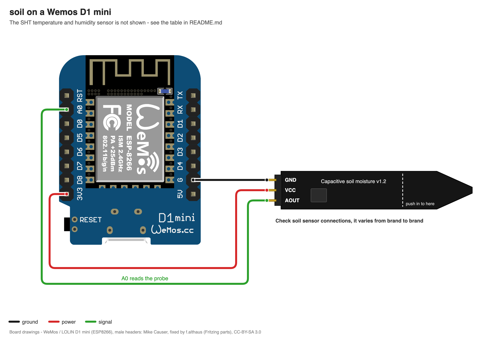

# Frugal-IoT Soil

Frugal IoT - Soil Moisture Sensor with SHT and Control

## Wiring

The capacitive probe takes 3V3, ground and one analog pin. Check the labels on your probe:
the order of its three pins varies from brand to brand. The SHT temperature and humidity
sensor is optional and goes on the board's I2C pins. Without it, the soil reading still works.

| Board | Probe AOUT | SHT SDA | SHT SCL |
|---|---|---|---|
| Wemos D1 mini, D1 mini Pro | A0 | D2 | D1 |
| LOLIN C3 Pico | 4 | 8 | 10 |
| LOLIN S2 Mini | 3 | 33 | 35 |
| NodeMCU-32S | 34 | 21 | 22 |

On every board, VCC on the probe and the SHT goes to 3V3, and GND goes to G (GND). The
pins are set per board in `platformio.ini` (`SENSOR_SOIL_PIN`), as are the probe's starting
dry and wet readings. On the C3 Pico, 3 is not used because it reads the battery. Those are only a starting point: press **Soil Moisture Tare** with the probe dry
in air, then put it in water and **Calibrate** to 100, in the node's setup page.

<!-- BEGIN generated by scripts/generate_platform_h.py - do not edit inside -->

## PlatformIO

    pio run -e <env>              # build
    pio run -e <env> -t upload    # build and flash
    pio run -e <env> -t uploadfs  # write data/ (wifi credentials, config)

`<env>` is a name from the table below, for example `c3_pico`.

Before flashing, give the node your organization's enrolment secret: copy
`templates/platformio-secrets-local.ini.template` from the library to
`platformio-secrets-local.ini` beside `platformio.ini`, and paste the line the dashboard
gives you (gear icon > Nodes > Enrolment secret) over the placeholder. Without it the node
is refused until an administrator approves it by hand. `platformio-local.ini.template` is
the optional one, for your own debug flags and serial port. Neither file is committed.

## Arduino IDE

1. **Tools > Manage Libraries**, search for **Frugal-IoT** and install it. When it asks
   about the libraries it depends on, choose **Install All**.
2. **Tools > Board > Boards Manager**, and install the one for your chip: **esp32** by Espressif Systems, or **esp8266** by ESP8266 Community (add `https://arduino.esp8266.com/stable/package_esp8266com_index.json` under **File > Preferences > Additional boards manager URLs** first).
3. **File > Examples > Frugal-IoT > soil**, then **Tools > Board** and pick the row
   for your hardware.
4. **File > Save As** to keep your own copy, then give it your organization's enrolment
   secret: copy `platform-secrets-local.h.template` from the library's `templates/` folder
   (in your sketchbook, under `libraries/Frugal-IoT`) into the sketch folder (**Sketch > Show
   Sketch Folder**) as `platform-secrets-local.h`, and paste the secret from the dashboard
   (gear icon > Nodes > Enrolment secret). Without it the node is refused until an
   administrator approves it by hand.

Opening `soil.ino` from a download or a git clone does not install the library, and
the build stops with *Frugal-IoT.h: No such file or directory* - do step 1 first.

| Tools > Board | configuration | also define |
| --- | --- | --- |
| LOLIN C3 Pico | `c3_pico` |  |
| LOLIN S2 Mini | `s2_mini` |  |
| NodeMCU-32S | `nodemcu-32s` |  |
| LOLIN(WEMOS) D1 mini Pro | `d1_mini_pro` |  |
| LOLIN(WEMOS) D1 R2 & mini | `d1_mini` |  |

Pick a board that is not in the table and the build stops with a message listing the ones
that are - rather than quietly compiling on the library's defaults, which for most boards
means the wrong pins.

Board not listed? `examples/all/platformio.ini` has `[env:]` sections for more boards,
including the LoRa ones. Copy one into this example's `platformio.ini`, add the pins this
example uses, and re-run `scripts/generate_platform_h.py` to rebuild `platform.h`.

## ESP8266: one extra step

In your saved copy, **Sketch > Show Sketch Folder** and rename
`X_soil.ino.globals.h` to `soil.ino.globals.h` - just remove the `X_`. If you
saved it under a new name, use that: `mytank.ino` needs `mytank.ino.globals.h`. Without it
the build stops with a message saying so. ESP32 and PlatformIO users leave the file alone.

The ESP8266 core reads only a file with exactly that name, which is how the settings in
`platform.h` reach it. The example cannot ship it under that name, because the Arduino IDE
then leaves the example out of **File > Examples**.

## If it does not fit

*"text section exceeds available space in board"* means this board's default flash
layout has less app space than the sketch needs. **Tools > Partition Scheme** and pick
**Minimal SPIFFS (1.9MB APP with OTA/128KB SPIFFS)** if your board offers it. Most of
these boards do not, and then:

1. **Sketch > Show Sketch Folder**, and rename `min_spiffs.csv` to `partitions.csv`.
2. **Tools > Partition Scheme >** choose **No OTA (2MB APP/2MB SPIFFS)**.

Over-the-air updates still work despite that menu label: step 1 is what sets the real
layout and it keeps both OTA slots. The menu choice only raises the size limit the IDE
checks against.

<!-- END generated -->
