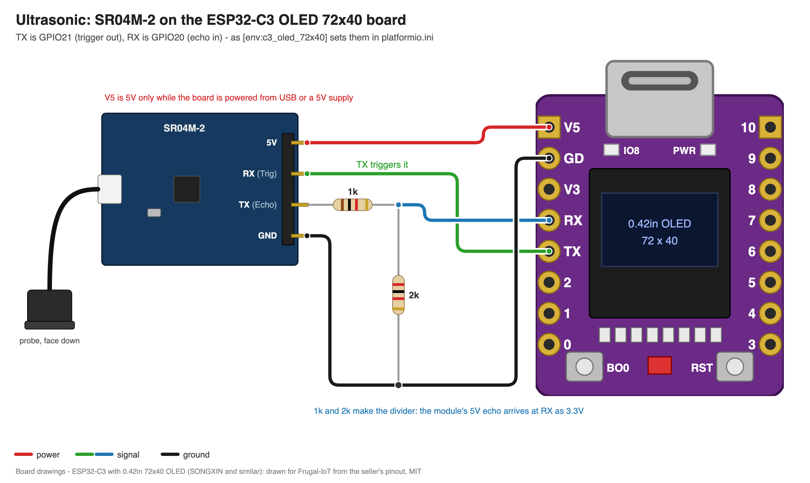

# Frugal-IoT Ultrasonic

Frugal IoT - an ultrasonic distance sensor. One sketch drives any of the ultrasonic modules the
library supports, so it works for measuring a tank, a well or a river level, or for detecting that
something is there. It publishes the distance in mm, or the depth of water if you give it the
height of the sensor (see "Depth instead of distance" below).

> **Ultrasonic sensors are tricky.** On a bench pointed at a wall they just work. Put one in a
> pipe, a tank or an enclosure and it can give a reading that looks perfectly reasonable, is the
> same every time, and has nothing to do with the distance. Before trusting a reading, **move the
> target and check the reading moves with it** - and read "Mounting" below, which is the part
> most likely to catch you out.

## Which sensor - one flag

| Module | Driver | In `platformio.ini` `[common] build_flags_frugaliot` |
| --- | --- | --- |
| HC-SR04, HC-SR04P | trigger/echo | nothing - this is the default |
| AJ-SR04M, SR04M-2 (waterproof, probe on a cable) as shipped | trigger/echo | `-D SENSOR_HCSR04_MIN_MM=200` `-D SENSOR_HCSR04_MAX_MM=4500` |
| AJ-SR04M, SR04M-2 with a 120k resistor on R19 | serial | `-D SENSOR_A01NYUB_WANT` `-D SENSOR_A01NYUB_MIN_MM=200` `-D SENSOR_A01NYUB_MAX_MM=4500` |
| DFRobot A01NYUB (28cm - 7.5m) | serial | `-D SENSOR_A01NYUB_WANT` |
| DFRobot A02YYUW (3cm - 4.5m) | serial | `-D SENSOR_A01NYUB_WANT` `-D SENSOR_A01NYUB_MIN_MM=30` `-D SENSOR_A01NYUB_MAX_MM=4500` |
| RS485 / Modbus module, e.g. A01ANY4B | RS485 | `-D SENSOR_ULTRASONIC_SLAVE_ID=1` plus the two `SYSTEM_RS485_*_PIN` lines already there, commented out |

All the lines are in `platformio.ini`, commented out, under **WHICH SENSOR**. The serial and RS485
modules need an ESP32 board: an ESP8266 has no spare serial port that can receive.

## Wiring

Every module uses the **same two ESP pins**, set for each board in `platformio.ini`:

* `SENSOR_ULTRASONIC_TRIG_PIN` - from the ESP **to** the module
* `SENSOR_ULTRASONIC_ECHO_PIN` - **from** the module to the ESP

| Board (`[env:]`) | `TRIG` | `ECHO` |
| --- | --- | --- |
| `c3_pico` | GPIO3 | GPIO4 |
| `c3_oled_72x40`, `supermini` | GPIO21 (printed TX) | GPIO20 (printed RX) |
| `s2_mini` | GPIO16 | GPIO18 |
| `nodemcu-32s` | GPIO18 | GPIO19 |
| `d1_mini`, `d1_mini_pro` | D5 (GPIO14) | D6 (GPIO12) |
| `ttgo-lora32-v21` | GPIO13 | GPIO14 |

### The one rule: nothing above 3.3V into an ESP pin

The ESP's pins take 3.3V at most. A module powered from **5V** sends its readings back at 5V, so
the wire to `ECHO` goes through a **divider**: one resistor in series from the module to the pin,
and one **twice as big** from the pin to GND. That gives 3.3V at the pin. Any pair in that ratio
works: 1k and 2k, 10k and 20k, or 4.7k and 9.4k (two 4.7k in series make the 9.4k). A module powered
from **3V3** needs no divider, but not every module works at 3.3V.

The wire from `TRIG` to the module has no resistors. 3.3V is enough to trigger an HC-SR04 at 5V,
but it may not be enough for an SR04M-2 at 5V - see below.

### HC-SR04

| HC-SR04 | ESP |
| --- | --- |
| VCC | 5V (VBUS, or the 5V pin) - it does not work at 3.3V |
| GND | GND |
| TRIG | `TRIG` |
| ECHO | `ECHO`, **through the divider** |

The **HC-SR04P** (and other boards using the RCWL-9610A chip) works from 3.3V. Power it from 3V3 and
leave out the divider.

### AJ-SR04M and SR04M-2 - trigger/echo, as shipped

The waterproof modules with a probe on a cable. The SR04M-2 is a later version of the AJ-SR04M
board, and the header is labelled differently:

| SR04M-2 label | AJ-SR04M label | What it is | ESP |
| --- | --- | --- | --- |
| 5V | VCC | supply | 5V - see below |
| RX | Trig | trigger input | `TRIG` |
| TX | Echo | echo output | `ECHO`, through the divider if powered from 5V |
| GND | GND | ground | GND |

Leave the RST and SWIM pads alone; they are for programming the board's own chip at the factory.

**5V or 3.3V?** The AJ-SR04M is rated 3.0 - 5.5V, but SR04M-2 listings say 5V. At 5V there is a
catch on the trigger wire as well as the echo one. The SR04M-2 is run by an STM8 chip, which at 5V
needs at least 3.5V (0.7 x 5V) to be sure a pin is HIGH. The ESP's 3.3V is just under that, so
some triggers can be missed, and the ping then gets no echo. If you see few echoes (below), try
in this order:

1. **Power it from 3V3.** Then the trigger is well above the chip's threshold, and you can leave
   out the divider. Check that it still reaches as far as you need.
2. **Keep 5V and lift the trigger** with a level shifter, or an NPN transistor (inverting -
   not supported here yet), on the `TRIG` wire.

Add `-D SENSOR_HCSR04_MIN_MM=200 -D SENSOR_HCSR04_MAX_MM=4500`. These modules use one transducer
to both send and listen, so they cannot hear anything closer than about 20 - 25cm. Closer than that
gives wrong readings, not none, which is why those readings are thrown away. If it never returns a
reading, try `-D SENSOR_HCSR04_TRIGGER_US=20`. If readings jump about, try
`-D SENSOR_HCSR04_INTERVAL_MS=100`.

#### Wiring diagram - SR04M-2 on the C3 OLED 72x40 board



* The board's 5V pin is only live when the board is powered from USB or another 5V supply. On a
  board with no 5V pin, take 5V from the USB supply.
* The 1k and 2k make the divider. RX (GPIO20) joins between them, and the 2k's other end goes to
  GND.
* TX and RX are GPIO21 and GPIO20, the chip's serial port. They are free because this board's
  serial monitor runs over USB. At reset the chip prints its boot messages on TX, which may fire
  the module once or twice. That does no harm.
* Check the labels on your module's header. Other batches may put the pins in a different order.
* The same wiring works in serial mode (next section). The green wire to the module's RX is then
  not used, so it can stay connected.

#### Few echoes - `1/5` or `0/5` in the debug output

With `-D SENSOR_HCSR04_DEBUG`, each reading prints what happened to every ping, then a summary:

```
hcsr04: ping us (0 no echo, - not fired, b busy) 1403 0 - - 0 b 1355 ...
hcsr04: 10 echoes from 122 pings (80 no echo, 30 not fired, 2 busy), median ...
```

| Shown | Means | Look at |
| --- | --- | --- |
| a number | an echo, round trip in µs | |
| `0` | the module fired but heard nothing within 30ms | the target, the mounting, the transducer |
| `-` | the module ignored the trigger - ECHO never went high | trigger level, trigger length, power |
| `b` | ECHO was still high from the last ping, so it was not triggered | `SENSOR_HCSR04_INTERVAL_MS` |

Each reading keeps pinging until it has `SENSOR_HCSR04_SAMPLES` echoes, or gives up after
`SENSOR_HCSR04_MAX_PINGS` pings, so an occasional miss costs a little time, not the reading.

Plenty of echoes, all at much the same time whatever the distance, is a different problem - see
"Readings stuck at 20-30cm" under Mounting. If most pings get nothing:

* Check the trigger level - see "5V or 3.3V?" above. This is the most likely cause on an SR04M-2
  at 5V.
* Point it at something big and flat 0.5 - 2m away. A small or angled target, or one inside the
  25cm blind zone, may not echo.
* `-D SENSOR_HCSR04_TRIGGER_US=20` for a longer trigger pulse.
* `-D SENSOR_HCSR04_INTERVAL_MS=100`. The single transducer rings for longer than an HC-SR04's.
* Check R19 is empty (next section). In serial mode it ignores the trigger and its readings arrive
  on the echo wire as serial data - you would see the odd short "echo" and mostly zeros.

### AJ-SR04M and SR04M-2 - which mode is mine in?

The mode is set by a resistor in the position marked **R19** on the board. Some batches mark it
differently, so look for an empty pair of pads near the label.

| R19 | Mode | Use |
| --- | --- | --- |
| empty (as shipped) | trigger/echo | the default build, as above |
| 120k | sends a reading over serial about every 100ms | `SENSOR_A01NYUB_WANT`, as below |
| anything else | low-power or on-request modes | not supported - remove the resistor |

To check without looking: build with `-D SENSOR_HCSR04_DEBUG` and point the probe at a wall 1 - 2m
away. If the serial monitor shows `0/5 echoes` on every reading and the wiring is right, the module
is probably in serial mode. Build again with `-D SENSOR_A01NYUB_WANT -D SENSOR_A01NYUB_DEBUG`. If
readings appear, keep that build and add the MIN_MM/MAX_MM lines from the table at the top.

### Serial modules: A01NYUB, A02YYUW, or an AJ-SR04M / SR04M-2 with 120k on R19

These modules send their reading over serial every 100 - 300ms on their TX wire. Only that one
wire goes to the ESP.

| A01NYUB / A02YYUW wire | SR04M-2 label | ESP |
| --- | --- | --- |
| Red (VCC) | 5V | 3V3 (no divider needed) or 5V (divider on the TX wire) |
| Black (GND) | GND | GND |
| White (TX) | TX | `ECHO` |
| Yellow (RX) | RX | **not connected** |

On the A01NYUB and A02YYUW the yellow wire picks the mode. Left unconnected, the module sends
filtered, steadier readings, which is what this example expects. Connected to GND, it sends raw
readings. Check the label on your cable: the wire colours are not the same on every batch.

### RS485 / Modbus modules, e.g. A01ANY4B

The module talks RS485 on two wires, A and B, which can run a long way. The ESP needs a small
**TTL-to-RS485 converter** board between them.

| Converter | Connect to |
| --- | --- |
| VCC | 3V3. If you use 5V instead, put the divider on RO |
| GND | GND (and the module's GND) |
| RO (or the pin marked as going to the MCU's RX) | `ECHO` |
| DI (or the pin marked as going to the MCU's TX) | `TRIG` |
| DE and RE, if the converter has them | join them, connect to a spare GPIO, and set `-D SYSTEM_RS485_DE_PIN=<that GPIO>` |
| A, B | the module's A and B |

Power the module itself as its label says; RS485 modules often want more than 5V. Uncomment
`SENSOR_ULTRASONIC_SLAVE_ID=1` and the two `SYSTEM_RS485_*_PIN` lines under it.

## Switching the module off while the node sleeps

`-D SENSOR_ULTRASONIC_POWER3v3_PIN=<gpio>` powers the module from that GPIO, so it is on only while
the node is awake. Connect the module's VCC to that GPIO instead of to 3V3 or 5V. Nothing is
switched while the node uses `Power_Loop`, which never sleeps.

A GPIO gives 3.3V and about 20mA at most. That is fine for an A01NYUB or A02YYUW, and for an
HC-SR04P. It is too little for an HC-SR04, which needs 5V, and marginal for an AJ-SR04M or
SR04M-2, which draw about 30mA while measuring. For those, switch the 5V through a transistor or a
load-switch board, and drive the switch from the GPIO. For an RS485 module the pin switches the
converter (and the module, if it is powered through the converter's supply).

## Mounting

* Mount the probe **at least its minimum range above the closest the surface will ever come**:
  2cm for an HC-SR04, about 25cm for the AJ-SR04M / SR04M-2, 28cm for an A01NYUB. Inside that,
  readings are wrong rather than missing.
* Point it straight down, clear of the tank walls and any pipes. The beam spreads out as it goes,
  and it reports the first thing it hits.
* Only the probe is waterproof. Keep the circuit board of an AJ-SR04M / SR04M-2 in a box.
* Nothing close beside the face of the transducer - see the next section.

### Readings stuck at 20-30cm - in a pipe, a cap or an enclosure (experimental)

**EXPERIMENTAL** - from one set of bench tests, an SR04M-2 over a 100mm pipe (2026-11), not yet
proven outdoors. Corrections and other results very welcome.

**The symptom:** steady readings of about 230-280mm (1300-1650µs in the debug output) that do not
change when the target moves. In that test, raising the pipe 50mm, taking the probe out of the
pipe, even pointing it at a floor 800mm away, all gave the same reading - as long as the face
of the transducer had a wall beside it. A cap that the probe sat inside did it, even with the
probe hanging loose by its cable, and so did the top of the pipe.

**What seems to be happening:** the AJ-SR04M, SR04M-2 and A01NYUB send and listen on the same
transducer, so they cannot hear anything until it has stopped ringing - that is the 20-28cm blind
zone. With a wall close beside the face, the sound is still bouncing between the walls when the
module starts listening, and it takes that as the echo. So the reading is not a distance to
anything; it is roughly the end of the blind zone. And because the module stops timing at the
first thing it hears, the real echo never reaches the ESP - no software filter can recover it.

**What worked:**

* **The face just above the top of the pipe**, with no wall beside it. Even a few mm clear gave
  correct readings. Weather may rule this out - a cover held well clear of the face, with a gap
  all round its bottom edge, should keep the rain off without putting a wall beside it.
* **Lining the top 100mm of the pipe** with something soft and loose that soaks up sound rather
  than reflecting it. A microfibre towel did it in the test; open-cell foam or synthetic felt
  should too. Closed-cell foam, rubber or hard plastic will not. Line the walls only, never across
  the face. Untested outdoors: anything that holds water reflects much more when wet, so felt that
  sheds water is a better bet than cloth or upholstery foam - check readings again after rain.
* **Not** a probe sitting up inside a cap or a recess. The face should be flush with, or stick
  out a little from, whatever holds it.

**Check it worked** by moving the target - raise the pipe off the table, or change the water
level - and watching the reading follow.

## Depth instead of distance

The sensor measures down to the surface. For the depth of water instead, set the sensor's
`offset` to the height of the probe above the tank floor in mm, and `scale` to -1. You can set
`offset` in the node's captive portal. Both can also be set over MQTT, or in the sketch, where the
commented-out lines show how. The values are saved on the node.

<!-- BEGIN generated by scripts/generate_platform_h.py - do not edit inside -->

# Compiling and Installing
## PlatformIO

    pio run -e <env>              # build
    pio run -e <env> -t upload    # build and flash
    pio run -e <env> -t uploadfs  # write data/ (wifi credentials, config)

`<env>` is a name from the table below, for example `c3_pico`.

Before flashing, give the node your organization's enrolment secret: copy
`templates/platformio-secrets-local.ini.template` from the library to
`platformio-secrets-local.ini` beside `platformio.ini`, and paste the line the dashboard
gives you (gear icon > Nodes > Enrolment secret) over the placeholder. Without it the node
is refused until an administrator approves it by hand. `platformio-local.ini.template` is
the optional one, for your own debug flags and serial port. Neither file is committed.

## Arduino IDE

1. **Tools > Manage Libraries**, search for **Frugal-IoT** and install it. When it asks
   about the libraries it depends on, choose **Install All**.
2. **Tools > Board > Boards Manager**, and install the one for your chip: **esp32** by Espressif Systems, or **esp8266** by ESP8266 Community (add `https://arduino.esp8266.com/stable/package_esp8266com_index.json` under **File > Preferences > Additional boards manager URLs** first).
3. **File > Examples > Frugal-IoT > ultrasonic**, then **Tools > Board** and pick the row
   for your hardware.
4. **File > Save As** to keep your own copy, then give it your organization's enrolment
   secret: copy `platform-secrets-local.h.template` from the library's `templates/` folder
   (in your sketchbook, under `libraries/Frugal-IoT`) into the sketch folder (**Sketch > Show
   Sketch Folder**) as `platform-secrets-local.h`, and paste the secret from the dashboard
   (gear icon > Nodes > Enrolment secret). Without it the node is refused until an
   administrator approves it by hand.

Opening `ultrasonic.ino` from a download or a git clone does not install the library, and
the build stops with *Frugal-IoT.h: No such file or directory* - do step 1 first.

| Tools > Board | configuration | also define |
| --- | --- | --- |
| LOLIN C3 Pico | `c3_pico` |  |
| LOLIN S2 Mini | `s2_mini` |  |
| NodeMCU-32S | `nodemcu-32s` |  |
| Nologo ESP32C3 Super Mini | `supermini` |  |
| LOLIN C3 Mini | `c3_oled_72x40` |  |
| LOLIN(WEMOS) D1 mini Pro | `d1_mini_pro` |  |
| LOLIN(WEMOS) D1 R2 & mini | `d1_mini` |  |
| TTGO LoRa32-OLED, with Board Revision = TTGO LoRa32 V2.1 (1.6.1) | `ttgo-lora32-v21` |  |

The LoRa board - TTGO LoRa32-OLED - also needs LoRaMesher, which is not in the Library Manager:

1. Download [LoRaMesher as a zip](https://github.com/loramesher/LoRaMesher/archive/refs/heads/main.zip) - leave it zipped.
2. **Sketch > Include Library > Add .ZIP Library**, and choose that file.
3. **Tools > Manage Libraries**, and install **RadioLib**, which LoRaMesher uses.

Without it the build stops with *loramesher.hpp: No such file or directory*.

Pick a board that is not in the table and the build stops with a message listing the ones
that are - rather than quietly compiling on the library's defaults, which for most boards
means the wrong pins.

## ESP8266: one extra step

In your saved copy, **Sketch > Show Sketch Folder** and rename
`X_ultrasonic.ino.globals.h` to `ultrasonic.ino.globals.h` - just remove the `X_`. If you
saved it under a new name, use that: `mytank.ino` needs `mytank.ino.globals.h`. Without it
the build stops with a message saying so. ESP32 and PlatformIO users leave the file alone.

The ESP8266 core reads only a file with exactly that name, which is how the settings in
`platform.h` reach it. The example cannot ship it under that name, because the Arduino IDE
then leaves the example out of **File > Examples**.

## If it does not fit

*"text section exceeds available space in board"* means this board's default flash
layout has less app space than the sketch needs. **Tools > Partition Scheme** and pick
**Minimal SPIFFS (1.9MB APP with OTA/128KB SPIFFS)** if your board offers it. Most of
these boards do not, and then:

1. **Sketch > Show Sketch Folder**, and rename `min_spiffs.csv` to `partitions.csv`.
2. **Tools > Partition Scheme >** choose **No OTA (2MB APP/2MB SPIFFS)**.

Over-the-air updates still work despite that menu label: step 1 is what sets the real
layout and it keeps both OTA slots. The menu choice only raises the size limit the IDE
checks against.

<!-- END generated -->
